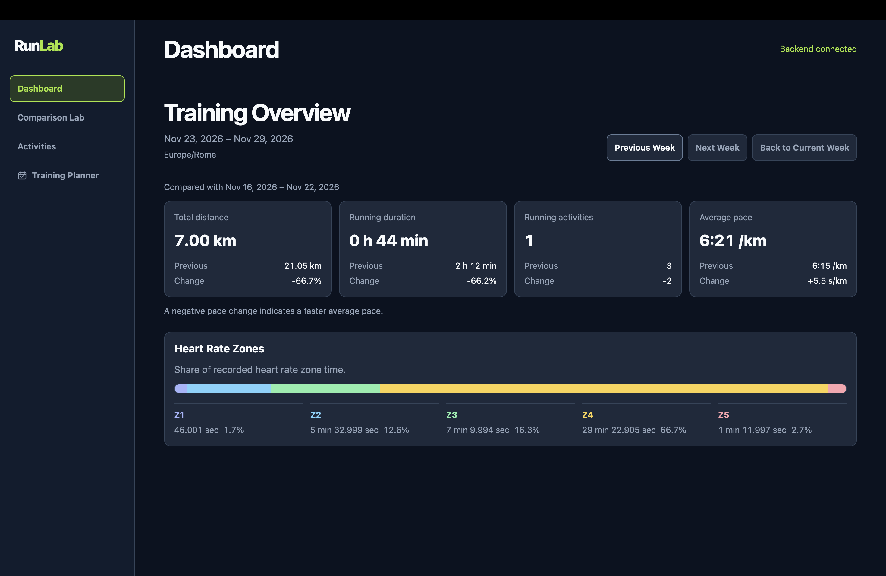
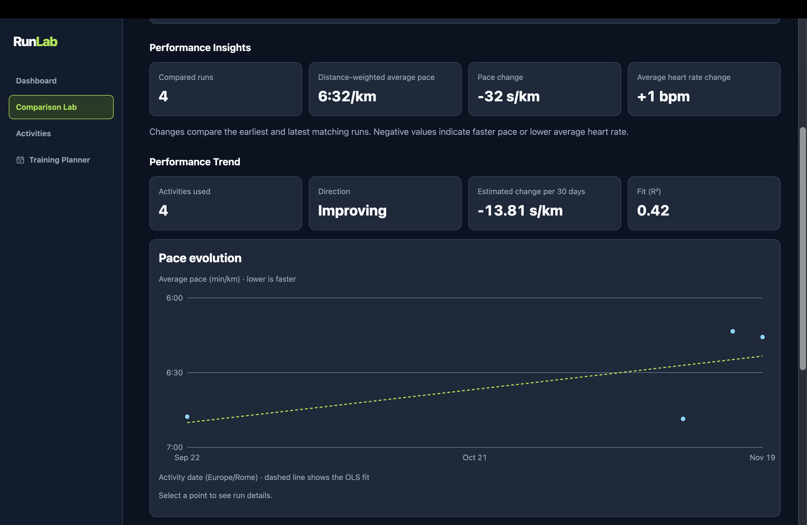
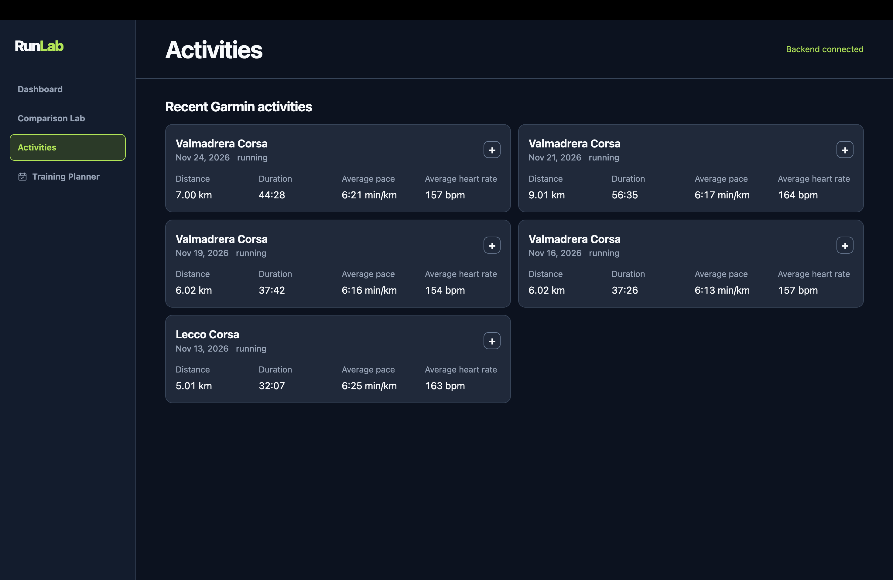
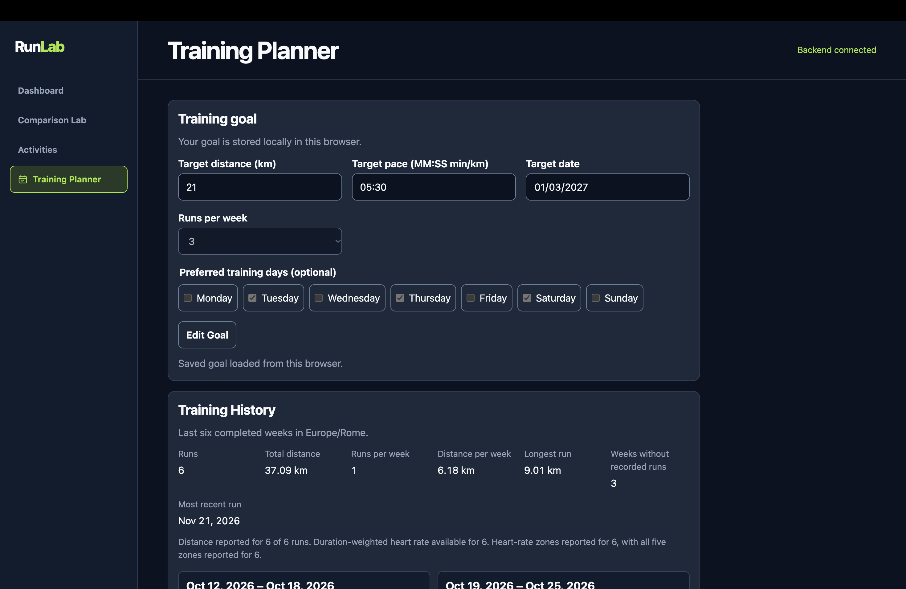
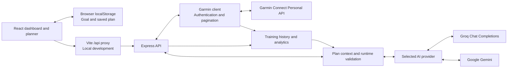

# RunLab

**Wearable Data Analytics & AI-Powered Running Intelligence**

RunLab is a full-stack running analytics project that turns Garmin Connect activity data into weekly training summaries, comparable-run analyses, and experimental AI-generated workout plans. It demonstrates a data pipeline from wearable API integration to physiological data analysis and a responsive React interface.




## Key Features

### Dashboard

Browse Europe/Rome training weeks, compare distance, duration, run count, and pace with the preceding week, and inspect Z1–Z5 time with coverage indicators.

### Comparison Lab

Match runs by distance and average heart rate within a selected date range. Inspect changes in pace and heart rate, distance-weighted pace, and an interactive ordinary least squares trend with R².



### Activities

Browse the five most recent Garmin activities. Expand a card for available distance, duration, pace, and heart rate.



### AI Adaptive Training Planner

Save a running goal, review six completed weeks of training, and request a plan for the next week. Workouts can include warm-up, timed efforts, repetitions and recoveries, cool-down, and a rationale.



## Architecture



The `client/` and `server/` directories are npm workspaces. The API owns Garmin access, training aggregation, and plan validation. The browser renders results and stores goals and plans locally. The server selects one configured AI provider per process.

## Engineering Highlights

- **Wearable integration.** The server exchanges a Garmin Personal API key for an access token, caches it in memory, and paginates activity searches. Weekly analytics use Monday–Sunday boundaries in Europe/Rome, including daylight-saving transitions.
- **Physiological data coverage.** Zone totals use Garmin’s recorded per-activity Z1–Z5 seconds. Missing readings stay distinct from recorded zero. The interface shows coverage and calculates percentages from reported zone time.
- **Performance analysis.** Comparison filters use inclusive distance and heart-rate tolerances. Ordinary least squares estimates change in pace over elapsed calendar days. The chart and trend metrics share the same fit.
- **Recency-aware AI context.** The planner prioritizes the latest completed week, uses the preceding week for comparison, and marks the current week as partial. It passes up to 12 recent run summaries with relative dates and available distance, pace, duration, heart rate, zone time, and cadence.
- **Provider-independent validation.** Groq uses strict JSON Schema output. Gemini uses its structured-output SDK interface. Both feed the same runtime checks for session dates, counts, phase totals, and current training limits. A provider can return a structured result explaining why it could not generate a plan.
- **Failure handling.** Identical in-flight generation requests share one operation. Provider deadlines and sanitized errors cover quota, timeout, configuration, and upstream failures. A failed regeneration leaves the previously saved plan visible.
- **Data privacy.** API keys stay server-side in environment variables. Provider requests include the saved goal and selected training metrics, with activity names, identifiers, and GPS tracks excluded. Development diagnostics report rules and numeric context without logging keys or full prompts.
- **Responsive interface.** Shared CSS tokens support a dark dashboard, mobile activity cards, keyboard-selectable chart points, and workout phase timelines. Hash navigation preserves mounted views and their state.

## Tech Stack

| Layer | Tools |
| --- | --- |
| Frontend | React 19, TypeScript 5.9, Vite 7, CSS and SVG |
| Backend | Node.js 24+, Express 5, TypeScript, native Fetch |
| Wearable data | Garmin Connect Personal API |
| AI | Groq OpenAI-compatible REST API, optional Google Gen AI SDK |
| Testing | Vitest 4 and Supertest 7 |

## Getting Started

### Prerequisites

- Node.js 24 or later and npm.
- A [Garmin Connect Personal API key](https://developer.garmin.com/gc-developer-program/personal/personal-api/) for wearable data.
- A Groq or Gemini API key for optional plan generation. Only the selected provider requires a key.

### Install and configure

Run these commands from the repository root.

```sh
npm ci
cp -n server/.env.example server/.env
```

Set the relevant variables in the Git-ignored `server/.env` file. Keep credentials out of source control and browser code.

| Variable | Purpose |
| --- | --- |
| `GARMIN_API_KEY` | Garmin key for activity and history requests |
| `AI_PROVIDER` | `groq` (default) or `gemini` |
| `GROQ_API_KEY` | Required for plan generation with Groq |
| `GROQ_MODEL` | Defaults to `openai/gpt-oss-120b`. Use a model supported by the strict-output adapter |
| `GEMINI_API_KEY` | Required for plan generation with Gemini |
| `GEMINI_MODEL` | Defaults to `gemini-3.5-flash-lite` |

### Run locally

```sh
npm run dev
```

Open [RunLab](http://127.0.0.1:5173). Vite forwards `/api` to Express at `http://127.0.0.1:3000`. Both development ports must be available. To generate a plan, open **Training Planner**, save a goal, and select **Generate Weekly Plan**.

## Testing and Code Quality

```sh
npm test
npm run typecheck
npm run build
```

The current suite has **156 passing tests** across 13 test files. It covers calendar boundaries, wearable pagination, analytics, plan generation and validation, and saved-plan compatibility. Garmin and AI requests are mocked. Supertest exercises the Express routes and strict TypeScript checking covers both workspaces. The build outputs are `client/dist` and `server/dist`.

## Current Limitations

- RunLab is designed for local, single-user operation. Goals and plans are stored per browser, with no account or cross-device sync.
- Garmin history depends on available and recorded data. Zone results describe reported time, and activity pace trends are descriptive estimates that cannot establish a change in aerobic fitness.
- AI training plans are experimental. Runtime checks enforce structure, consistency, and application heuristics. They cannot establish coaching accuracy or medical safety. Provider availability, quota, and data-handling policies apply. [Groq data policy](https://console.groq.com/docs/your-data) · [Gemini API terms](https://ai.google.dev/gemini-api/terms)
